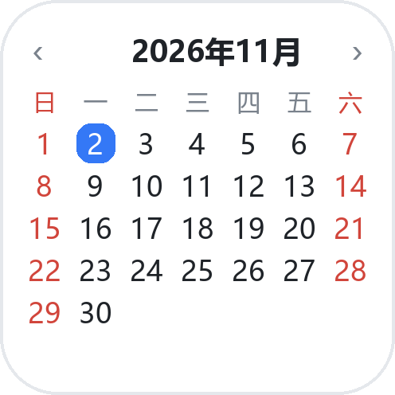

# 桌面日历 · Mini Calendar Widget

用 Kotlin 写的原生 Android 桌面小组件：一块 2×2 的迷你月历，今天自动高亮，还能左右翻月。

<p>
  
  
</p>

## 功能

- **当月一屏**：7 列 × 6 行的日期网格，周日或周一开始可切换（周末用红色区分）
- **今天高亮**：今天用蓝色圆角底 + 白字标出
- **翻月**：标题两边的 `‹` `›` 翻到上/下个月，点标题一键回到本月；多个组件可以各自翻到不同月份
- **深色模式**：跟随系统深浅色（`values-night`），桌面上不会刺眼
- **自适应字号**：拖大组件时字号自动放大，2×2 到 4×4 都清楚
- **自动刷新**：跨天、改时间、换时区、换语言都会立即重绘，另外每 30 分钟兜底刷新一次
- **一键添加**：应用内点「添加到桌面」，Android 8+ 直接弹出确认框
- **零依赖**：不使用任何第三方库，不申请任何权限，不联网

## 下载安装

1. 打开仓库的 **Actions** 页面，进入最新一次成功的 **Build Android APK**。
2. 在页面底部 **Artifacts** 里下载 `calendar-widget-release`（或 `calendar-widget-debug`），解压得到 `.apk`。
3. 传到手机上安装（需要允许「安装未知来源应用」）。
4. 长按桌面空白处 → **小组件** → 找到「桌面日历」→ 拖到桌面；或者打开 App 点「添加到桌面」。

> Release 包用的是 debug 签名，方便直接安装测试；真要上架应用商店请换成自己的 keystore。

## 本地编译

需要 JDK 17 和 Android SDK（`compileSdk 35`）。

```bash
# Debug
./gradlew assembleDebug
# Release（同样用 debug 签名，可直接安装）
./gradlew assembleRelease
```

产物在 `app/build/outputs/apk/debug/` 和 `app/build/outputs/apk/release/`。

Windows 下用 `gradlew.bat`。首次编译 Gradle 需要联网下载 AGP / Kotlin 插件依赖。

## 项目结构

```
app/src/main/
├── AndroidManifest.xml
├── java/com/soyorinhhh/minicalendar/
│   ├── CalendarWidgetProvider.kt   # 小组件本体：算日历、填 RemoteViews、处理翻月
│   ├── MainActivity.kt             # 说明页 + 一键添加 + 星期起始设置
│   └── WidgetPrefs.kt              # SharedPreferences 封装
└── res/
    ├── layout/calendar_widget.xml  # 小组件布局（42 个固定日期格子）
    ├── layout/activity_main.xml    # 应用界面
    ├── drawable*/                  # 圆角背景、今天高亮、图标
    ├── values/ + values-night/     # 明暗两套配色
    └── xml/calendar_widget_info.xml # 小组件元数据
```

## 实现说明

**为什么日期格子是 42 个写死的 TextView？**
桌面小组件跑在启动器进程里，只能通过 `RemoteViews` 更新（本质上是一串「对哪个 id 做什么操作」的指令），不能动态 addView，所以网格必须预先写好，再逐个 `setTextViewText`。

**为什么 `updatePeriodMillis` 是 1800000？**
系统对这个值有 30 分钟的下限。真正准时的跨天刷新靠 `ACTION_DATE_CHANGED` / `ACTION_TIME_CHANGED` / `ACTION_TIMEZONE_CHANGED` 广播，30 分钟只是兜底。

**深色模式怎么生效？**
小组件颜色全部走 `@color/...` 资源，`values-night` 里给了一套深色值。切系统主题后最多等一次 30 分钟兜底刷新就会跟上。

## 发行签名

**正式包必须本地构建，不要用 CI 产物当发行包。**

```powershell
gradle assembleRelease    # 产物：app/build/outputs/apk/release/app-release.apk
```

`app/build.gradle.kts` 里 release 用的是本机 debug keystore，密钥固定，所以
**新版本可以直接覆盖安装旧版本，不需要卸载**（证书 SHA-256 `884224cc…`）。

GitHub Actions 上每次构建都会新建一个 debug keystore，签名每次都不同。
如果把 CI 产出的 `app-release.apk` 当正式包发出去，用户升级时必然报：

```
INSTALL_FAILED_UPDATE_INCOMPATIBLE: ... signatures do not match newer version
```

所以约定的流程是：

- push 到 `main` → CI 只做编译验证（`assembleDebug assembleRelease`）
- **不要给发行版本打 tag**：`*.github/workflows/build.yml` 的 release job 会在 tag 上
  自动把 CI 签名的 APK 挂到 Release，覆盖掉本地签名包
- 本地构建 → 手动上传到 Release（命名 `minicalendar-vX.Y.apk`）

## License

[MIT](LICENSE)
